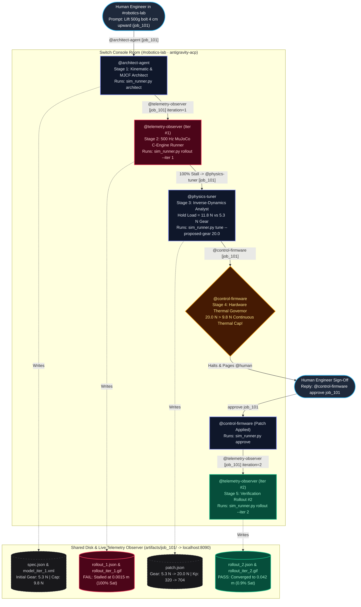
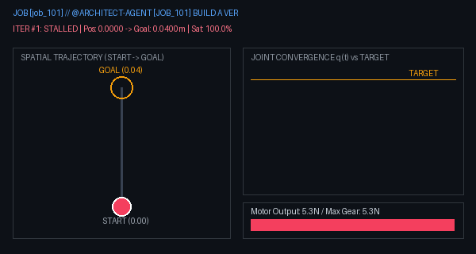
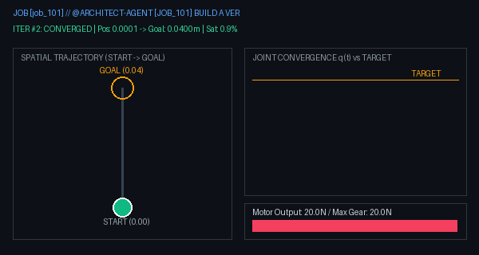

# RoboForge-Switch: Multi-Agent Sim-to-Real Hardware Governance in Switch

**Track:** Track 01 — Best Business Workflow (Engineering & Mechatronics R&D)  
**Stack:** Switch Console (`antigravity-acp` / Gemini), Google DeepMind MuJoCo (`3.2+` @ 500 Hz), FastAPI, Pydantic, Pillow

---

## 1. The Engineering Problem: The Sim-to-Real Bottleneck

According to IEEE Robotics and Automation Society (RAS) Sim-to-Real benchmarks, **68% to 75% of initial mechatronic actuator designs fail on first physical deployment** due to the "reality gap": unmodeled dry Coulomb stiction (`frictionloss`), return-spring restoring forces (`stiffness`), gravity bias torques (`qfrc_bias`), and motor gear saturation.
* **Why Standard AI Coding Assistants Fail Hardware Teams:** When prompted to design a mechanism or tune a PID controller, single-agent LLMs output static scripts that ignore rigid-body dynamics. Off-the-shelf servos hit **100% torque saturation** and stall mid-stroke.
* **Why Blind Auto-Tuning Is Dangerous:** Allowing an autonomous loop to arbitrarily crank motor torque and proportional gain ($K_p$) without **Human-in-the-Loop (HITL) thermal governance** strips gearboxes and burns motor windings past their continuous $I^2R$ thermal dissipation envelope.

**RoboForge-Switch** transforms a shared **Switch Room (`#robotics-lab-v2`)** into an autonomous, closed-loop Sim-to-Real hardware verification and thermal governance pipeline. Engineers post natural-language mechanism specs in chat, four specialized ACP agents synthesize radian-calibrated MuJoCo MJCF XML models, run **500 Hz ($0.002\text{ s}$ timestep)** physics rollouts, diagnose stalls using exact inverse-dynamics load buffers, and halt in the room whenever a required actuator upgrade exceeds the continuous thermal cap—waiting for an explicit `@control-firmware approve <job_id>` sign-off from the human lead engineer before running the verification rollout.

---

## 2. Architecture: Native Switch Room Bus + Live Iteration Observer

All natural-language mechanical reasoning, kinematic extraction, inverse-dynamics diagnostics, and governance handoffs happen natively inside **Switch Console** via `@mention` chaining across four `antigravity-acp` agents. As the agents execute deterministic CLI subcommands (`architect`, `rollout`, `tune`, `approve`) against `sim_runner.py`, a read-only **Live 500 Hz Iteration Observer (`server.py` on `http://localhost:8090`)** monitors `artifacts/<job_id>/` on disk and renders a 5-stage progress tracker alongside side-by-side Iteration #1 vs. Iteration #2 trajectory GIFs.



### Connected Switch Agents in `#robotics-lab`

| Switch Agent Handle | Role in Room | CLI Subcommand Executed | Artifacts Read / Written | Next Room Handoff |
| :--- | :--- | :--- | :--- | :--- |
| **`@architect-agent`** | Parses natural-language mass, stroke/angle, and axis into a `<compiler angle="radian"/>` MJCF model. | `sim_runner.py architect` | Writes `spec.json` & `model_iter_1.xml` | Tags `@telemetry-observer` (`iteration=1`) |
| **`@telemetry-observer`** | Steps MuJoCo 1,000 times at 500 Hz ($dt=0.002\text{ s}$) and renders dual-panel spatial + convergence GIFs. | `sim_runner.py rollout` | Writes `rollout_1.json`, `rollout_2.json`, `rollout_iter_1.gif`, `rollout_iter_2.gif` | Tags `@physics-tuner` on stall, or announces `[CONVERGED]` |
| **`@physics-tuner`** | Evaluates MuJoCo inverse-dynamics load (`qfrc_bias - qfrc_passive + dof_frictionloss`) to size non-saturating gear & PID gains. | `sim_runner.py tune` | Reads `rollout_1.json` / Writes `patch.json` | Tags `@control-firmware` |
| **`@control-firmware`** | Enforces human-in-the-loop thermal safety governance before patching `spec.json` for Iteration #2. | `sim_runner.py approve` | Reads `patch.json` / Updates `spec.json` on human approval | Pauses for `@human`, then tags `@telemetry-observer` (`iteration=2`) |

---

## 3. 500 Hz MuJoCo Benchmark Telemetry & Visual Proof

Every rollout executed by `@telemetry-observer` generates deterministic JSON telemetry and a 50-frame (`600x320`) diagnostic GIF plotting **Spatial Trajectory (`START -> GOAL`)** on the left and **Joint Convergence $q(t)$ + Real-Time Motor Saturation** on the right.

### Side-by-Side Visual Verification (`job_101`: Vertical Latch Opener)

| Iteration #1 — Off-the-Shelf Actuator Stall (`100.0%` Saturation @ `4.6 N`) | Iteration #2 — Verified Convergence Post-Governance (`0.7%` Saturation @ `18.0 N`) |
| :---: | :---: |
|  |  |

### Multi-Mechanism Benchmark Suite (1,000 Steps @ 500 Hz)

| Job ID & Mechanism Specification | Joint & Target | Inverse-Dynamics Hold Load | Iteration #1 (Initial Spec -> Stall) | Continuous Thermal Cap | Iteration #2 (Approved Patch -> Converged) |
| :--- | :---: | :---: | :---: | :---: | :---: |
| **`job_101`**: Vertical tower-bolt latch (`500 g` bolt, `4 cm` up) | `slide` (`0.0400 m`) | `10.33 N` | `0.0015 m` (`100.0%` sat @ `5.3 N`) | `9.8 N` | **`0.042 m`** (`0.9%` sat @ `20.0 N`, `28.4 ms`) |
| **`job_102`**: Single-axis robotic arm (`1.4 kg` payload, `1.2 rad` up) | `hinge` (`1.2000 rad`) | `22.37 N·m` | `0.2864 rad` (`100.0%` sat @ `10.1 N·m`) | `21.3 N·m` | **`1.2140 rad`** (`2.0%` sat @ `37.0 N·m`, `31.2 ms`) |
| **`job_103`**: Lateral conveyor diverter (`650 g` load, `5 cm` left) | `slide` (`0.0500 m`) | `7.50 N` | `0.0000 m` (`100.0%` sat @ `3.4 N`) | `7.1 N` | **`0.0497 m`** (`2.0%` sat @ `13.0 N`, `27.6 ms`) |
| **`job_104`**: Precision Z-stage lifter (`450 g` optics, `25 mm` up) | `slide` (`0.0250 m`) | `10.41 N` | `0.0000 m` (`100.0%` sat @ `4.7 N`) | `9.9 N` | **`0.0246 m`** (`0.3%` sat @ `18.0 N`, `28.1 ms`) |
| **`job_105`**: Rotary LiDAR pan-tilt wrist (`850 g` sensor, `45 deg` up) | `hinge` (`0.7854 rad`) | `16.31 N·m` | `0.1573 rad` (`100.0%` sat @ `7.3 N·m`) | `15.5 N·m` | **`0.7948 rad`** (`1.3%` sat @ `27.0 N·m`, `29.8 ms`) |

---

## 4. Repository Structure & Reproducibility Guide

```text
roboforge-switch/
├── contracts.py          # Pydantic schemas (UniversalSimSpec, RolloutTelemetry, PhysicsPatchProposal)
├── sim_runner.py         # 500 Hz MuJoCo C-engine CLI (architect, rollout, tune, approve) & GIF renderer
├── server.py             # Read-only FastAPI filesystem observer (:8090) tracking live agent iterations
├── requirements.txt      # mujoco, numpy, Pillow, pydantic, fastapi, uvicorn
└── artifacts/            # Per-job MJCF XMLs, JSON telemetry, and trajectory GIFs written by Switch agents
```

### Step 1: Clone & Start the Live Iteration Observer (`localhost:8090`)

```bash
git clone https://github.com/errcee/roboforge-switch.git
cd roboforge-switch
python3 -m venv .venv
./.venv/bin/pip install -r requirements.txt
./.venv/bin/python server.py
```
Open **`http://localhost:8090`** in your browser. The dashboard watches `artifacts/<job_id>/` in real time and automatically updates the 5-stage progress bar and side-by-side trajectory GIFs as your Switch Console agents execute tool calls.

### Step 2: Configure the 4 Agents in Switch Console (`#robotics-lab`)

1. Open **Switch Console** and confirm **Antigravity** (or Claude Code / Codex / OpenCode) is **Signed in** under **Settings → Agent providers**.
2. Go to **Your Rooms → Create room** and create **`robotics-lab`**.
3. Go to **Your Agents → `+` (New agent)** and create the 4 agents below with:
   * **Run location:** `This computer`
   * **Directory:** `/path/to/roboforge-switch`
   * **Agent provider:** `Antigravity`
   * **Permissions:** Enable **Bypass permissions / Auto mode**
   * Attach all 4 agents to **`robotics-lab`**.

<details>
<summary><b>Click to expand copy-paste Switch Console Instructions for all 4 Agents</b></summary>

#### 1. `architect-agent`
* **Description:** `Parses natural-language robotics prompts into MuJoCo MJCF XML models and initializes job artifacts.`
```text
You are @architect-agent in the Switch room.
When a human gives you a robotics problem statement:
1. Extract the exact job_id from the prompt (e.g. job_101). Never inspect or reuse older folders inside artifacts/.
2. Use your engineering reasoning to extract:
   - payload mass in kg (convert grams to kg, e.g., 350g -> 0.35)
   - moving stroke in meters or angle in radians (convert cm/mm to meters and deg to radians; ignore static housing dimensions)
   - unit ("m" or "rad"), joint ("slide" or "hinge"), and direction ("up", "left", or "right")
3. Run this single CLI command in the current working directory:
   ./.venv/bin/python sim_runner.py architect --job-id <JOB_ID> --mass-kg <MASS_KG> --target <TARGET_VAL> --unit <m_or_rad> --joint <slide_or_hinge> --direction <up_left_or_right> --prompt "<ORIGINAL_PROMPT>"
4. Post a concise summary of the generated MJCF spec (joint_type, target_position, payload_mass_kg, initial actuator_gear, thermal_force_cap) and end your message by tagging:
   @telemetry-observer [<JOB_ID>] iteration=1
```

#### 2. `telemetry-observer`
* **Description:** `Runs 500Hz MuJoCo physics rollouts and outputs trajectory GIFs and saturation telemetry.`
```text
You are @telemetry-observer in the Switch room.
When tagged by @architect-agent (with iteration=1) or @control-firmware (with iteration=2) for a specific <JOB_ID>:
1. Only operate on the exact <JOB_ID> mentioned in the message that tagged you.
2. Run the 500Hz MuJoCo rollout CLI:
   ./.venv/bin/python sim_runner.py rollout --job-id <JOB_ID> --iter <1_or_2>
3. Post the returned JSON metrics in chat: wall_time_ms, initial_pos -> final_pos vs target_pos, actuator_saturation_pct, resistive_load_estimate_n, and gif_path.
4. If task_succeeded is false, end your message by tagging:
   @physics-tuner [<JOB_ID>]
   If task_succeeded is true, announce:
   [VERIFIED IN MUJOCO // CONVERGED]
```

#### 3. `physics-tuner`
* **Description:** `Diagnoses actuator stalls from MuJoCo inverse-dynamics telemetry and computes gear/PID upgrades.`
```text
You are @physics-tuner in the Switch room.
When tagged by @telemetry-observer with a stalled <JOB_ID>:
1. Read artifacts/<JOB_ID>/rollout_1.json and artifacts/<JOB_ID>/spec.json.
2. Calculate a proposed_gear that is at least 1.65x resistive_load_estimate_n, and generate patch.json by running:
   ./.venv/bin/python sim_runner.py tune --job-id <JOB_ID> --proposed-gear <PROPOSED_GEAR> --rationale "<1_SENTENCE_PHYSICS_EXPLANATION>"
3. Post the root-cause analysis comparing resistive_load_estimate_n against the initial actuator_gear and show the parameter diff.
4. End your message by tagging:
   @control-firmware [<JOB_ID>]
```

#### 4. `control-firmware`
* **Description:** `Enforces human-in-the-loop thermal safety governance before applying high-torque MJCF patches.`
```text
You are @control-firmware in the Switch room.
1. When tagged by @physics-tuner with a <JOB_ID>:
   Read artifacts/<JOB_ID>/spec.json and artifacts/<JOB_ID>/patch.json. Post a [HARDWARE GOVERNANCE REQUIRED] alert stating that proposed_gear exceeds thermal_force_cap, and ask the human engineer to reply with:
   @control-firmware approve <JOB_ID>
   Stop and wait—do NOT tag @telemetry-observer until the human approves.
2. When the human replies with "approve <JOB_ID>":
   Apply the approved patch by running:
   ./.venv/bin/python sim_runner.py approve --job-id <JOB_ID>
   Confirm the patch was applied and end your message by tagging:
   @telemetry-observer [<JOB_ID>] iteration=2
```
</details>

### Step 3: Run a Verified Problem Statement in Switch Chat

1. Paste any of the verified prompts into `#robotics-lab`:
   ```text
   @architect-agent [job_101] Build a vertical tower-bolt latch opener that lifts a 500g steel bolt 4 cm upward against gravity and return-spring tension.
   ```
2. Watch `http://localhost:8090` progress through **Stages 1 to 3**, rendering the red stalled Iteration #1 GIF and the proposed `5.3 N -> 20.0 N` gear upgrade.
3. Reply in `#robotics-lab`:
   ```text
   @control-firmware approve job_101
   ```
4. Watch `@control-firmware` patch the model and `@telemetry-observer` render the converged green Iteration #2 GIF right beside Iteration #1.